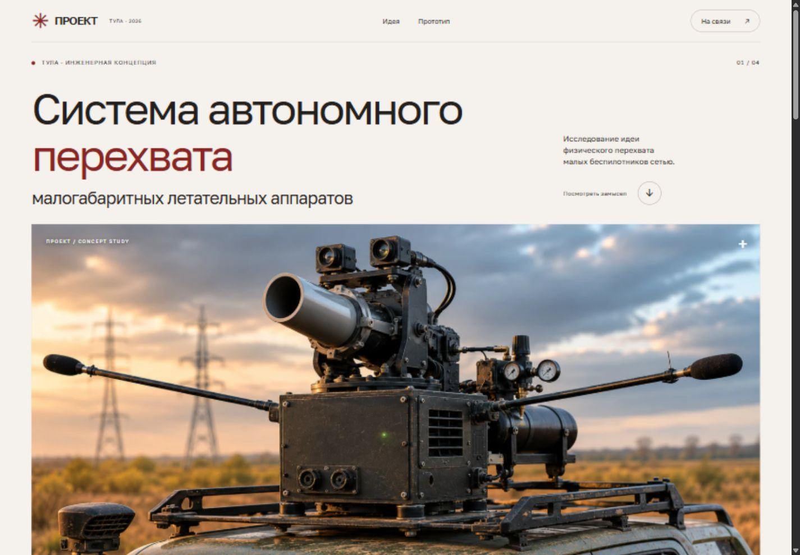

# Сетевик — сайт проекта

Адаптивная выставочная страница инженерного проекта. Рассказывает о концепции и показывает настольный демонстратор визуального сопровождения ладони.



## Что реализовано

- Вёрстка для телефона и компьютера на HTML, CSS и JavaScript.
- SVG-анимация из трёх глав с паузой, перемоткой и выбором скорости.
- Интерактивная иллюстрация настольного стенда и видеозапись демонстрации.
- Локальные шрифты, адаптивные WebP-изображения и поддержка reduced motion.

Полная концепция и художественная анимация не являются подтверждением испытаний перехвата. Реализованный настольный стенд отслеживает ладонь.

## Запуск

Сборка и npm не нужны. Установите Python 3 и запустите из корня репозитория:

```sh
python -m http.server 8000 --directory public --bind 127.0.0.1
```

Откройте `http://127.0.0.1:8000`.

`public/` содержит все публикуемые файлы. `vercel.json` настраивает размещение этой папки на Vercel. Golos Text распространяется по включённой лицензии `public/assets/Golos-OFL.txt`.
